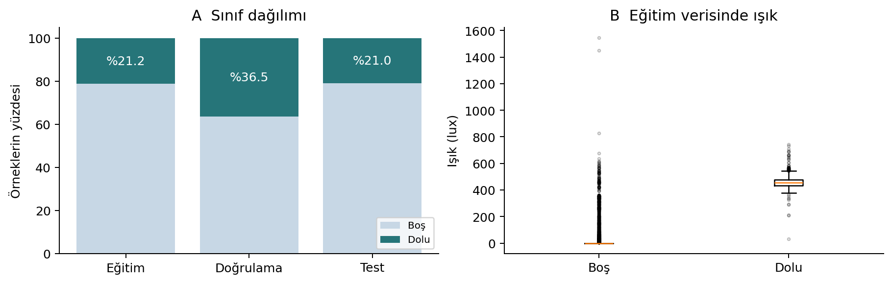
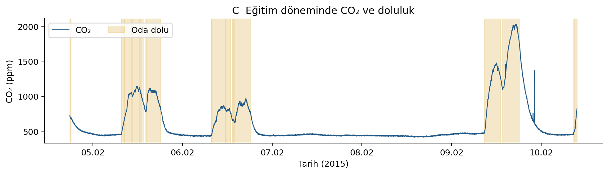
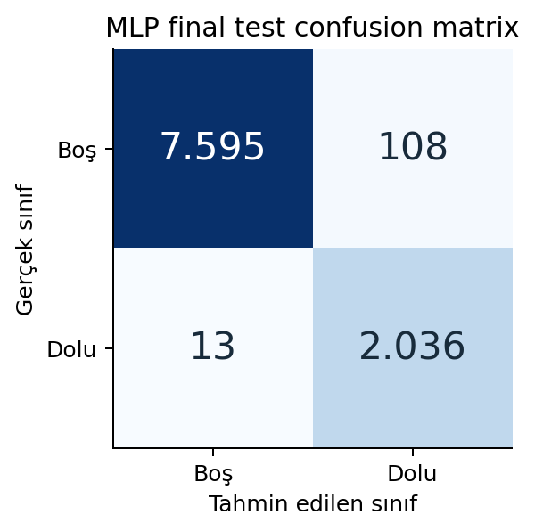
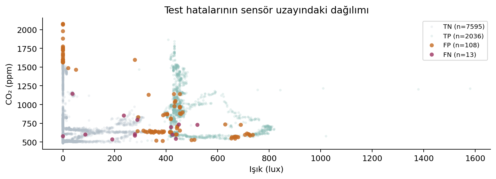

# Çevresel Sensör Verileriyle Oda Doluluk Tespiti

Makine ve Derin Öğrenme Uygulamaları Proje Raporu

Hazırlayan: Mert Ali Korkmaz

Staj kurumu: Software Persona

Tarih: 9 Kasım 2026

Bu çalışmada beş çevresel sensör ölçümünden bir odanın dolu veya boş olduğu tahmin edilmiştir. PyTorch ile geliştirilen küçük bir yapay sinir ağı, ayrılmış final test verisinde %98,76 doğruluk ve %97,11 F1 elde etmiştir. Çalışma; veri keşfi, eğitim verisine dayalı ölçekleme, validation ile model seçimi ve karşılaştırmalı hata analizini içeren bir öğrenme projesidir.

## 1 Problem tanımı

Odaların kullanım durumunun tahmini, aydınlatma ve iklimlendirme sistemlerinin kullanım ihtiyacına göre yönetilmesine katkı sağlayabilir. Bu projede sıcaklık, bağıl nem, ışık, CO2 ve nem oranı girdi olarak kullanılmıştır. Hedef değişken Occupancy olup 0 boş, 1 dolu odayı göstermektedir. Amaç, her ölçüm satırını bu iki sınıftan birine atayan ve terminalden kullanılabilen bir model geliştirmektir.

## 2 Veri seti ve değişkenler

UCI Occupancy Detection veri setinin hazır bölümleri kullanılmıştır [1]. Toplam 20.560 örnekte sıcaklık (°C), bağıl nem (%), ışık (lux), CO2 (ppm) ve HumidityRatio (kg su buharı/kg hava) bulunur. Tarih ve satır kimliği model girdisi değildir. Kaynaktaki doluluk etiketleri, dakikada bir çekilen zaman damgalı fotoğraflardan elde edilmiştir.

| Bölüm ve dosya | Örnek | Dolu | Dönem 2015 |
| --- | --- | --- | --- |
| Eğitim / datatraining.txt | 8.143 | 1.729 | 4-10 Şubat |
| Validation / datatest.txt | 2.665 | 972 | 2-4 Şubat |
| Final test / datatest2.txt | 9.752 | 2.049 | 11-18 Şubat |

## 3 Veri ön işleme

Beş özellikte eksik veya sonlu olmayan değer görülmemiştir; kümeler içinde yinelenen zaman damgası ve kümeler arasında ortak zaman damgası yoktur. Sayısal girdiler için encoding gerekmez. Standartlaştırma (x - ortalama) / standart sapma ile uygulanmış; istatistikler yalnızca eğitim verisinden hesaplanmıştır. Standart sapmada correction=0 kullanılmış, sıfır değerler 1 ile değiştirilmiştir. Validation, test ve tahmin aşamaları aynı eğitim istatistiklerini kullanır.

Eğitimde 1,5 IQR kuralı ışıkta 15, CO2’de 1.063 ve nem oranında 118 uç değer işaretlemiştir. Bunlar ölçüm hatası olarak doğrulanmadığından veri silinmemiştir; dolulukla ilişkili yüksek CO2 değerlerini otomatik silmek bilgi kaybına neden olabilir.

## 4 Veri keşfi ve görsel bulgular

İlk analiz sınıf dengesini, ikinci ve üçüncü analizler sensörlerle doluluk arasındaki ilişkiyi inceler. Sensör dağılımı ve zaman grafiği yalnızca eğitim verisinden üretilmiştir.

A Sınıf dağılımı. Dolu örnek oranı eğitimde %21,23, validation’da %36,47 ve testte %21,01’dir. Bu dengesizlik nedeniyle yalnızca accuracy yeterli değildir: testte sürekli boş tahmini bile %78,99 doğruluk verirken dolu sınıfının recall ve F1 değerleri sıfırdır.

B Işık dağılımı. Eğitimde ışık medyanı boş odada 0 lux, dolu odada 454 lux’tür. Bu ayrım ışığın yararlı bir girdi olduğunu düşündürür. Dağılımların örtüşmesi ve uç değerler, ışığın tek başına hatasız bir doluluk göstergesi olmadığını gösterir.

C Zaman içindeki değişim. Eğitimde CO2 medyanı boş odada 446 ppm, dolu odada 944 ppm’dir. Grafikte doluluk dönemleriyle birlikte yükselişler görülür; geçişler anlık ve kusursuz değildir. Havalandırma ve sensör tepkisi gibi etkiler olası açıklamalardır, bu veriyle nedensellik kanıtlanmaz.

Veri zaman damgalı olsa da mevcut model geçmiş ölçümleri bir dizi olarak kullanmaz. Bu çalışma, her satırın bağımsız değerlendirildiği bir ikili sınıflandırma uygulamasıdır.

## 5 Model seçimi ve mimari

Beş sayısal girdi arasındaki doğrusal olmayan ilişkileri öğrenebilmek için çok katmanlı algılayıcı (MLP) seçilmiştir. Küçük yapı, PyTorch ile öğrenme sürecinde katmanların ve gradyan güncellemelerinin anlaşılmasını kolaylaştırır. Bu seçim tüm yöntemlere üstünlük iddiası taşımaz; daha basit bir yöntemle karşılaştırma ayrıca yapılmıştır.

| Katman | Boyut | Aktivasyon | Parametre |
| --- | --- | --- | --- |
| Gizli katman 1 | 5 → 16 | ReLU | 96 |
| Gizli katman 2 | 16 → 8 | ReLU | 136 |
| Çıkış katmanı | 8 → 1 | Ham logit | 9 |
| Toplam |  |  | 241 |

ReLU doğrusal olmayan dönüşüm sağlar. Kayıp fonksiyonu BCEWithLogitsLoss olduğundan forward çıktısına sigmoid eklenmemiştir. Değerlendirmede sigmoid ile skor elde edilir; skor ≥ 0,5 ise dolu, aksi hâlde boş tahmin edilir. Skorların kalibrasyonu ayrıca doğrulanmamıştır.

## 6 Eğitim ve validation yaklaşımı

| Ayar | Değer | Ayar | Değer |
| --- | --- | --- | --- |
| Optimizer | Adam | Öğrenme oranı | 0,001 |
| Batch size | 32 | Üst epoch sınırı | 100 |
| Patience | 5 | PyTorch seed | 42 |

Her epoch’ta eğitim batch’leri karıştırılır; zero_grad, forward, backward ve optimizer.step sırasıyla uygulanır. Ardından eval modunda, gradyan hesaplanmadan validation kaybı ölçülür. Kayıp önceki en iyi değerden büyük değilse ağırlıkların bağımsız kopyası saklanır; aksi durumda sayaç artar. Beş ardışık iyileşmeme durumunda eğitim durur; en iyi ağırlıklar geri yüklenerek kaydedilir.

Mevcut checkpoint değerlendirilmiş, MLP yeniden eğitilmemiştir. Seçilen epoch ve epoch bazlı kayıp geçmişi checkpoint’te tutulmadığından eğitim eğrisi üretilmemiştir. Seed, farklı paket sürümleri ve donanımlarda aynı sonucu tek başına garanti etmez.

## 7 Basit modelle karşılaştırma yöntemi

Logistic Regression, doğrusal karar sınırına sahip bir temel model olarak kullanılmıştır [2]. StandardScaler ve model yalnızca eğitim bölümünde fit edilmiştir. Ayarlar test sonucu görülmeden C=1, solver=lbfgs, max_iter=1000 ve random_state=42 olarak sabitlenmiş; model 12 iterasyonda yakınsamıştır. Her iki modelde aynı beş özellik ve 0,5 eşiği kullanılmıştır. Bu karşılaştırmada hiperparametre araması veya test verisine göre yeniden model seçimi yapılmamıştır.

Orijinal validation dönemi eğitimden önce gelmektedir; bu nedenle geleceğe yönelik bir validation simülasyonu değildir. Final test eğitimden sonraki ayrı dönemdedir. Zaman damgası çakışmaması olumlu olmakla birlikte, yakın zamanlı ölçümler arasında bağımlılık bulunabilir.

## 8 Değerlendirme sonuçları

| Model ve bölüm | Accuracy | Precision | Recall | F1 |
| --- | --- | --- | --- | --- |
| MLP validation | %97,86 | %94,63 | %99,79 | %97,15 |
| MLP final test | %98,76 | %94,96 | %99,37 | %97,11 |
| Logistic final test | %98,51 | %97,41 | %95,46 | %96,43 |
| Hep boş final test | %78,99 | %0,00 | %0,00 | %0,00 |

MLP kaybı eğitimde 0,0426, validation’da 0,0770 ve final testte 0,0694’tür. Metriklerde pozitif sınıf dolu odadır. Accuracy tüm doğru tahminlerin payını; precision dolu tahminlerinin doğruluğunu; recall gerçek dolu örneklerin yakalanma oranını gösterir. F1, precision ile recall’un harmonik ortalamasıdır.

MLP, 2.049 dolu örneğin 2.036’sını yakalamış, 13’ünü kaçırmıştır. Boş örneklerin 108’ini dolu tahmin etmiştir. Logistic Regression’da bu sayılar sırasıyla 93 kaçırılan dolu örnek ve 52 yanlış dolu tahminidir. MLP’nin F1 değeri 0,69 yüzde puan daha yüksek; Logistic Regression’ın precision değeri daha yüksektir.

Dolu bir odayı boş saymanın daha maliyetli olduğu bir kullanımda MLP’nin yüksek recall’u yararlı olabilir. Yanlış dolu tahminlerinin gereksiz enerji kullanımına yol açabileceği bir uygulamada ise precision da önemlidir. Gerçek işletme maliyetleri ölçülmediğinden tek bir modelin tüm kullanım senaryoları için daha iyi olduğu söylenemez.

Sonuçlar aynı ofisin sabit veri bölümlerindeki gözlemlerdir; bağımsız binalara genellenebilirlik ve modeller arasındaki farkın istatistiksel anlamlılığı bu çalışmada sınanmamıştır.

## 9 Hata analizi

Final testte 121 yanlış tahmin vardır. Yanlış pozitif (FP), boş odaya dolu; yanlış negatif (FN), dolu odaya boş denmesidir. Aşağıdaki değerler hata ve doğru tahmin gruplarının medyanlarını karşılaştırır; neden-sonuç ilişkisi göstermez.

| Grup | Örnek | Işık medyanı lux | CO₂ medyanı ppm | Geçişe yakın |
| --- | --- | --- | --- | --- |
| TN doğru boş | 7.595 | 0,00 | 585,00 | 44 |
| FP yanlış dolu | 108 | 361,25 | 862,75 | 39 |
| FN yanlış boş | 13 | 279,33 | 603,67 | 13 |
| TP doğru dolu | 2.036 | 447,50 | 895,88 | 71 |

Geçişe yakınlık, test etiketinin değiştiği ilk kaydın zamanından en fazla 120 saniye uzaklık olarak tanımlanmıştır. FN grubundaki 13 örneğin tamamı bu aralıktadır; FP grubunda 39/108 örnek bu aralıktadır. Bu tanımlama gerçek test etiketlerini kullanan geriye dönük bir incelemedir; model girdisi veya model ayarlama adımı değildir.

FP grubunun ışık ve CO2 medyanlarının doğru boş grubundan yüksek olması, bazı boş ölçümlerin dolu ölçümlere benzemesiyle uyumludur. Örneğin kronolojik ilk FP, 11 Şubat 15:23:59’da 436,5 lux ve 1.047 ppm ile %96,58 doluluk skoru üretmiştir. İlk FN ise aynı gün 18:23:59’da 279,33 lux ve 585 ppm ile %28,48 skor üretmiştir. Sensör gecikmesi veya odadan çıkıldıktan sonra yüksek kalan değerler olası açıklamalardır; doğrulanmış nedenler değildir.

## 10 Sonuç ve geliştirme önerileri

Küçük MLP, bu veri bölümünde yüksek recall ve F1 sağlamış; daha basit Logistic Regression da güçlü bir temel model olmuştur. Tek ofis ve sınırlı dönem, sınıf oranı değişimi ve geçiş hataları başlıca sınırlamalardır. Gelecekte farklı oda ve dönemlerden veri toplanmalı, zaman sırasını koruyan validation uygulanmalı ve geçmiş sensör ölçümlerini kullanan modeller incelenmelidir. Eşik ve kalibrasyon çalışmaları validation üzerinde yürütülmeli; geliştirme sonrasında kullanılmak üzere yeni bir bağımsız test seti ayrılmalıdır.

## Kaynaklar ve yeniden üretim

[1] Candanedo, L. (2016). Occupancy Detection. UCI. doi.org/10.24432/C5X01N. Veri lisansı CC BY 4.0; veri dosyaları değiştirilmemiştir.

[2] scikit-learn, LogisticRegression belgeleri: scikit-learn.org.

Kod, veri, grafikler ve analiz: github.com/merttro/smart-room-occupancy.

Analiz komutu: python analysis/analyze.py. Python 3.11.9; PyTorch 2.14.1+cpu; NumPy 1.26.4; scikit-learn 1.8.0; Matplotlib 3.10.9.
